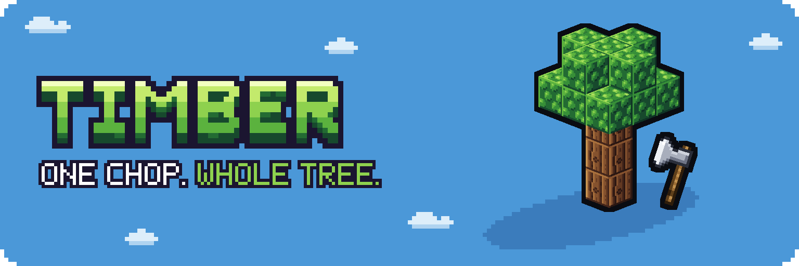
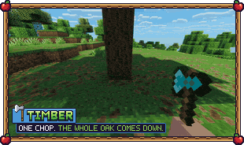
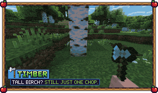
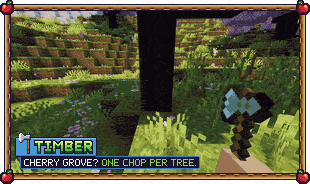
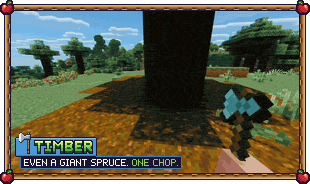
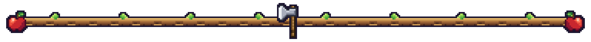

**Chop one log and the whole tree comes down, cartoon style.**

Timber 2.0 is a mod for **Minecraft Java 26.3, 26.2, 1.21.1 and 1.20.1** on **Fabric, Quilt, NeoForge and Forge**. Put it on the server and everyone who joins sees the tree fall, even with an unmodified game. Put it on your own game too and the fall is drawn smoothly on your screen. It replaces the Timber data pack, so existing worlds and the mod's CurseForge page carry on from 1.3.x.

|  |  |
| --- | --- |
|  |  |

- **The whole tree falls, cartoon style.** It shivers, drops onto the stump, leans back with a creak, bends as it tips over, slams down and splats its crown, then pops apart log by log.
- **Any tree.** Every overworld tree including the 2×2 giants, the nether fungi (crimson and warped), the huge red and brown mushrooms, and modded trees that use ordinary logs and leaves. Modpack makers can describe a new kind of tree with a data pack.
- **Smooth on your screen.** With the mod on your game, the fall is drawn on your client, the leaves keep their biome colour while they fall, and shader packs shade the tree like any other entity. Players without the mod see the same fall drawn with vanilla display entities.
- **One tree at a time.** In a crowded forest, neighbouring trees keep their own logs and leaves.
- **Never fells builds.** Logs you placed are left alone, and so is anything without a leafy crown.
- **Falls where it makes sense:** away from you, or into open space when something is in the way.
- **The forest can grow back.** Turn on auto-replant (`replant` 1) and a free sapling is planted in the stump when the tree has fallen. Giant 2×2 trees get four. It's off by default.
- **Mind the trunk.** The falling tree knocks back mobs in its way, and hostile ones take a little damage. Players are never touched.
- **Everything attached comes along,** such as vines, cocoa, hanging moss and snow.
- **Safe for servers.** Land claims and other protections are asked about every block before a tree falls. If the server crashes mid-fall, the loot is waiting at the stump on the next start. A multi-break mod fells one tree, not twenty.
- **Fair durability.** The axe pays for the whole tree, Unbreaking included. A tree that would break your axe isn't felled. Drops are the normal block drops for your axe, Fortune and Silk Touch included.
- **Everyone chooses.** Any player can turn it off or on for themselves with `/trigger timber`.

1. Hold an axe.
2. Chop a log of a natural tree.

Sneak to take a single log instead. Creative mode never fells trees, so building stays instant. When a tree isn't felled, the action bar tells you why: too big, your axe is too worn, or part of it is protected.

Settings live in `config/timber.json` on the server. The file is re-read while the game runs, so edits apply without a restart. Operators can also use `/timber config` to list the settings, `/timber config <setting> <value>` to change one, `/timber reload` to re-read the file, and `/timber menu` for a clickable menu.

You can set the biggest tree (logs and leaves), how far a tree may reach, how sneaking works, where drops land, whether an axe is needed, durability use, the animation (off makes the tree vanish and drop at the stump), placed-log protection, auto-replant (`replant`, off by default), trunk knockback (`knockback`) and its damage to hostile mobs (`trunk_damage`), and the action bar messages.

**[Enchanted Timber](https://www.curseforge.com/minecraft/mc-mods/enchanted-timber)** turns tree felling into an axe enchantment you have to find first, and works with Timber 2.0.

Making your own add-on? The data pack hooks from 1.x still work (`#timber:api/cancel`, `#timber:api/loaded`), and mods get a Java hook, `TimberEvents.CANCEL`. See the [add-on API](https://github.com/ProfetGit/timber/blob/main/docs/api.md).

Put the jar in the `mods` folder of the server (or your singleplayer game). On Fabric and Quilt it needs Fabric API. Players can join with an unmodified game. Putting the mod on their client as well gives them the smoother fall.

**Works with.** The falling tree is tested alongside Sodium, Iris with Complementary, Entity Culling, Continuity, Seamless Displays and Snappy Blocks, and a Flashback replay shows the fall.

**Conflicts.** FallingTree and HT's TreeChop also fell trees. If either is installed, Timber warns the operators and the log. Use only one of them.

**Coming from Timber 1.3.x?** Remove the old data pack or jar and add this one. The first time a 1.3.x world loads, Timber brings over the placed-log protection, your settings and each player's on/off choice, returns any drops that were mid-fall, and switches off the old data pack. Operators are told once in chat.

**On 1.20.1** one jar serves Forge and NeoForge. The data pack hook `#timber:api/cancel` doesn't run there (the Java hook does), and players without the mod see a steppier fall than on newer versions.

To uninstall, remove the jar. Nothing is left behind in the world.

## More from Profet

<!-- promo:start -->
|  |  |
| --- | --- |
|  |  |
<!-- promo:end -->

© 2026 Profet. All rights reserved.

- **You can** use Timber on any server, including monetized ones, include it in modpacks that credit Profet and link here, feature it in videos and modify it for your own world or server.
- **Please don't** re-upload it or a modified version, sell it, or present it as your own.

Full terms: [LICENSE](https://github.com/ProfetGit/timber/blob/main/LICENSE).

Timber is free. If it saves you some chopping, a coffee helps fund the next update.

Want your own server to play on with friends? My BisectHosting affiliate link gives you 25% off the first month, and I get a small commission.

**More from Profet:** [GitHub](https://github.com/ProfetGit/timber) (source and issues) · [Ko-fi](https://ko-fi.com/profetgit)

